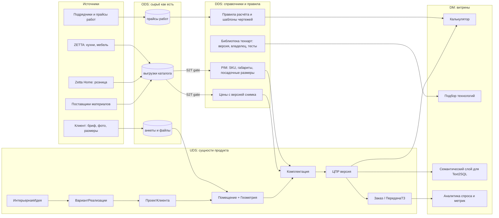

# Архитектура данных

Слои: ODS (сырые выгрузки) > DDS (очищенные справочники и правила) > UDS (бизнес-сущности
продукта) > DM (витрины для калькулятора и аналитики). Новый источник каталога не
попадает в DDS без согласованного S2T-маппинга (`s2t-mapping.md`): это gate.

## Что принципиально

- Цены хранятся с `catalog_snapshot`; ЦПР ссылается на снимок и не меняется задним числом.
- Геометрия хранится в мм (контур), сцена 1 unit = 1 м. Единицы не смешиваются.
- Допущения (`assumptions`) хранятся как данные, а не как текст в комментарии.
