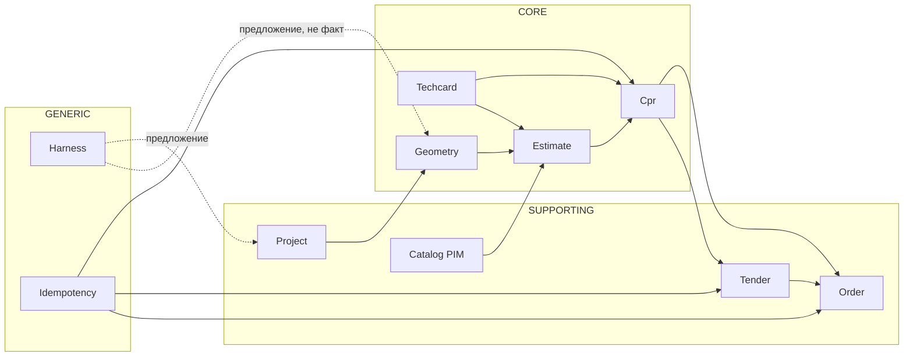

# План переписывания ZettaCalc на Go в DDD-архитектуре

Статус: реализовано (шаги 0–6), см. §13 «Фактическая реализация». Не меняет
контракты `schemas/` и не отменяет `AGENTS.md`: детерминированное ядро без LLM,
цены/SKU только из PIM, code-based ACL, write только с `Idempotency-Key`,
метрика `pass^k`.

## 1. Зачем переписывать и что именно

Переписывается **бэкенд-ядро** (`src/domain`, `src/rules`, `src/harness`,
`src/api`), а не документы, схемы и evals-фикстуры. Фронтенд (Vue) и mock API
остаются как есть; Go-сервис встаёт за тот же OpenAPI (`schemas/openapi/cpr.yaml`).

Мотивы:

- один статически типизированный бинарь вместо Python-рантайма: предсказуемые
  деплой, память и cold start;
- явные границы контекстов через пакеты и правила зависимостей, а не через
  соглашения;
- дешёвый параллелизм для `pass^k`-прогонов и батч-расчётов.

Не мотивы: скорость «любой ценой». Целевые SLA из
`docs/architecture/service-architecture.md` (p95 чтения PIM < 200 мс,
rule engine < 500 мс, расчёт < 3 с) достигаются и на Python; Go выбран как
технологический стандарт, а не как оптимизация.

Критерий успеха миграции — не «код на Go», а **паритет поведения**:
на одних и тех же фикстурах Go-ядро даёт те же JSON-байты (после
`json.Marshal` с сортировкой ключей и фиксированным `now`), и `pass^k` на
`tests/fixtures/cpr/*` не ниже текущего.

## 2. Bounded contexts

Разбиение выводится из `docs/architecture/uds-er.md` и списка сервисов, а не
из текущей структуры Python-файлов.

| Контекст | Тип | Агрегат-корень | Инварианты |
|---|---|---|---|
| Catalog (PIM) | supporting | `CatalogSnapshot` | цена и габариты только из снимка; неизвестный SKU — ошибка, не 0 ₽ |
| Geometry | core | `Room` (контур, проёмы) | 1 unit = 1 m; площадь только из контура, не из брифа |
| Techcard / Rule Engine | core | `Techcard` (code+version) | обязательные операции не удаляются; неизвестные условия > `needs_review`, не «по умолчанию» |
| Estimate | core | `Estimate` | линии только по SKU из снимка; диапазон растёт от числа допущений и ограничен 25% |
| CPR | core | `Cpr` (version, status) | статус-машина; `approved_for_tender` только человеком с ролью expert |
| Project | supporting | `Project` | бриф и допущения версионируются; геометрия принадлежит помещению |
| Tender & Contractor | supporting | `Tender` | ставки сравнимы только по одному ЦПР; `awarded` — единственная терминальная победа |
| Order | supporting | `Order` | создание только по согласованному ЦПР, только с идемпотентностью |
| AI harness | generic | `Run` (трейс) | бюджет шагов/токенов/рублей, anti-loop, запись только через approval-gate |

Связи (направление «зависит от» — только вниз, без циклов):



Правило из ADR-0001 переносится буквально: harness может **предлагать**
(углы, размеры, формулировки), но ни один путь от `harness` не ведёт в
`Estimate` или `Cpr` минуя домен.

## 3. Структура репозитория

Каждый контекст — отдельный модуль со слоями `domain / app / adapters`.
Внутренние пакеты не импортируются снаружи контекста (в Go это делается
через `internal/`).

```text
cmd/
  api/main.go              # composition root HTTP
  worker/main.go           # асинхронные задачи (outbox, evals)
internal/
  catalog/                 # PIM
    domain/                # Sku, CatalogSnapshot, UnknownSkuError
    app/                   # GetItem, SyncFromS2T (порт источника)
    adapters/pg/           # репозиторий снимков
    adapters/httpapi/      # GET /catalog/items/{sku}
  geometry/
    domain/                # Contour, Room, Opening, AreaM2()
    app/                   # SaveGeometry, ValidateContour
    adapters/httpapi/
  techcard/
    domain/                # Techcard, Conditions, Operations, Selection
    app/                   # Select(surface) (Selection, error)
    adapters/fs/           # загрузка techcards/*.json
  estimate/
    domain/                # Estimate, EstimateLine, Uncertainty
    app/                   # Calculate(projectID)
  cpr/
    domain/                # Cpr, Status, transitions, Checklist
    app/                   # Build, Approve (роль expert)
    adapters/httpapi/
  project/
  tender/
  order/
  harness/
    domain/                # Budget, Trace, Step, WritePolicy
    app/                   # Run, anti-loop
    adapters/llm/          # единственная точка вызова LLM
  platform/
    idempotency/           # middleware + хранилище ключей
    auth/                  # роли, code-based ACL
    clock/                 # TimeSource (детерминизм в тестах)
    jsonx/                 # канонический JSON для golden-тестов
pkg/
  api/                     # сгенерированные типы из OpenAPI (oapi-codegen)
schemas/                   # как есть, источник правды
tests/
  golden/                  # ожидаемые JSON ЦПР
  contract/                # валидация ответов по JSON Schema
  evals/                   # pass^k сценарии
```

Правила зависимостей (проверяются тестом, см. §9):

1. `domain` не импортирует ничего, кроме stdlib.
2. `app` импортирует свой `domain` и объявленные им порты (`interface`),
   но не `adapters` и не чужие `app`.
3. `adapters` импортируют свой `app`/`domain`; кросс-контекстные вызовы идут
   только через `app`-интерфейсы, объявленные на стороне потребителя.
4. `cmd` — единственное место, где собираются конкретные реализации.

## 4. Домен в Go: как переносятся текущие инварианты

Перенос делается не «файл в файл», а по инвариантам. Соответствие:

| Python | Go | Что важно сохранить |
|---|---|---|
| `Contour.area_m2` (shoelace) | `geometry.Contour.AreaM2() (float64, error)` | тот же порядок операций и округление до 2 знаков — иначе golden-тест площадей упадёт |
| `select_techcard` | `techcard.Select(surface, cards)` | при `reasons` карта не применяется; при неизвестной неровности — допущение, карта применяется |
| `build_estimate` | `estimate.Calculate` | `UnknownSkuError` → доменная ошибка, а не ноль |
| `build_cpr` | `cpr.Build` | `now` снаружи (никакого `time.Now()` внутри), одинаковый вход → одинаковый выход |
| `runtime.run_agent` | `harness.Run` | лимиты шагов/токенов/рублей, anti-loop на 3 повторах, `write_denied` в трейс |
| `guardrails.check_write_allowed` | `platform/auth.CanWrite(policy)` | `allow_write && approved` |

Типы: деньги — `int64` в копейках (не `float64`), площади — `float64` с явным
округлением в одном месте, идентификаторы — типизированные строки
(`type CprID string`) с валидацией формата `CPR-YYYY-NNNNNN` в конструкторе.
Это меняет внутреннее представление, но **не** JSON: на границе суммы
сериализуются как раньше (`number` в рублях), паритет проверяется golden-тестами.

Ошибки: доменные ошибки — типы с `errors.Is/As`
(`ErrUnknownSKU`, `ErrTechcardNotApplicable`, `ErrInvalidTransition`), маппинг
в HTTP-коды — только в `adapters/httpapi` (422 / 409 / 403 / 402 по OpenAPI).

## 5. Контракты

- OpenAPI остаётся источником правды. Кодогенерация серверных типов и
  роутинга из `schemas/openapi/cpr.yaml` (кандидат — `oapi-codegen`;
  альтернатива — ручные типы + контрактный тест). Выбор фиксируется ADR.
- Валидация ЦПР по `schemas/json/cpr.schema.json` в тестах и на входе
  (кандидат — `santhosh-tekuri/jsonschema/v6`), чтобы не разъезжаться со схемой.
- Правило из `tests/contract/test_openapi.py` переносится как есть: **каждый**
  write-метод обязан объявлять `Idempotency-Key` (исключение — `/files`).
- Обратная совместимость: Go-сервис обязан отвечать на те же пути и те же
  коды; фронтенд и mock API не меняются.

## 6. Write-safety

Три механизма, все — на уровне платформы, а не в домене:

1. **Idempotency-Key** — middleware: ключ + хэш тела → сохранённый ответ.
   Повтор с тем же ключом и телом отдаёт тот же ответ и код; с другим телом —
   `409`. Хранилище: PostgreSQL, TTL по регламенту (кандидат — 7 суток).
2. **dry-run** — `?dry_run=true` для `buildCpr` и `createOrder`: проходят все
   проверки и возвращают тело, но транзакция откатывается.
3. **approval-gate** — переход `Cpr` в `approved_for_tender` возможен только
   при роли `expert` и закрытом чек-листе; в домене это метод
   `Cpr.Approve(actor Actor, at time.Time)`, который проверяет оба условия
   и пишет в `audit`.

Транзакционность: домен возвращает события, `app` пишет агрегат и события в
одной транзакции (outbox). Никаких сетевых вызовов внутри транзакции.

## 7. Хранилище

- PostgreSQL, драйвер `pgx`; миграции — версионированные файлы (кандидат —
  `goose` или `atlas`), схема выводится из `uds-er.md`.
- Снимок цен обязателен: `catalog_snapshot` в ЦПР ссылается на неизменяемый
  набор SKU+цен, иначе старые ЦПР «поплывут» при обновлении прайса.
- Техкарты — версионированные записи (`code` + `version` + `owner`), а не
  только файлы; файлы остаются как seed и как источник для `check_techcards`.
- Репозитории объявляются интерфейсами в `app`, реализуются в `adapters/pg`.

## 8. Наблюдаемость и эксплуатация

- Логи — `log/slog`, структурные, с `project_id`/`cpr_id`/`trace_id`.
- Метрики: длительность по контекстам, доля `pending_review`, число отказов
  по идемпотентности и ACL, стоимость harness-прогонов.
- Трейс harness пишется в БД (шаги, стоимость, `stop_reason`) — это часть
  аудита, а не отладка.

## 9. Тестовая стратегия (главный риск миграции)

| Уровень | Что проверяет | Инструмент |
|---|---|---|
| domain unit | инварианты: неровность > лимита → нет карты; неизвестный SKU → ошибка | table-driven `go test` |
| golden | JSON ЦПР на `tests/fixtures/cpr/*` совпадает с эталоном байт-в-байт | `jsonx` + `-update` флаг |
| contract | ответы проходят `cpr.schema.json`; все write имеют `Idempotency-Key` | JSON Schema + разбор YAML |
| evals | `pass^k`, k=10, на тех же кейсах | `go test ./tests/evals` |
| architecture | `domain` не тянет `adapters`; нет циклов между контекстами | тест по `go list -deps` |
| fuzz | контур с самопересечением, вырожденные полигоны | `go test -fuzz` |

`pass^k` остаётся обязательным: сборка ЦПР должна быть воспроизводимой, а не
«в среднем правильной». Тест детерминизма: два прогона с одним `now` дают
идентичные байты.

## 10. Этапы миграции (strangler fig)

| Этап | Объём | Выход (DoD) |
|---|---|---|
| 0. Каркас | `go.mod`, `cmd/api`, health, CI на Go | сборка и `go vet` в CI, OpenAPI-роут отвечает 501 |
| 1. Catalog + Geometry | чтение PIM, площадь контура | паритет площадей на фикстурах, p95 < 200 мс |
| 2. Techcard + Estimate | подбор карт, расчёт с диапазоном | `pass^k` на `kitchen_small/uneven`, неизвестный SKU → 422 |
| 3. CPR | сборка, версии, статусы, approve | golden-паритет ЦПР, approve только expert |
| 4. Tender + Order | аукцион, ставки, заказ | идемпотентность и dry-run покрыты тестами |
| 5. Harness | бюджеты, anti-loop, tool layer | запись запрещена без approval, трейс в БД |
| 6. Cutover | Go за тем же OpenAPI, Python — read-only эталон | паритет на проде 2 недели, затем удаление Python-ядра |

Откат: этапы 1–5 живут за флагом маршрутизации; при расхождении трафика
переключается обратно на Python без миграции данных (схема общая).

## 11. Риски

| Риск | Проявление | Мера |
|---|---|---|
| Расхождение округлений | площади/суммы отличаются в последнем знаке | golden-тесты с фиксированным `now`, один хелпер округления |
| Потеря «мягких» правил | неизвестное условие молча трактуется как допустимое | домен возвращает `needs_review` + причину, тест на каждый отказ |
| Дублирование логики контекстов | цена считается и в `estimate`, и в `cpr` | правило: расчёт только в `estimate`, ЦПР потребляет результат |
| Идемпотентность «для галочки» | повтор заказа создаёт второй заказ | middleware-тест на повтор с тем же/другим телом |
| Соблазн вызвать LLM из ядра | недетерминированный ЦПР | arch-тест: `harness` не импортируется из `core` |

## 12. Что нужно подтвердить человеком

1. Go как целевой стек бэкенда (сейчас в `pyproject.toml` зафиксирован Python).
2. Библиотеки: роутер, кодогенерация OpenAPI, миграции, валидатор JSON Schema.
3. Хранилище: PostgreSQL как единственная БД v1.
4. Судьба Python-кода: эталон для паритета на время миграции или удаление
   сразу после cutover.

## 13. Фактическая реализация

Ниже — что сделано и чем отличается от первоначального плана. Код: `backend/`.

### 13.1. Границы и маршруты

Сервис закрывает **весь HTTP-контракт mock API** (`vue-prototypes/api/main.py`),
а не только ядро расчёта: 173 маршрута — контент, статика прототипов, картинки,
авторизация, корзина, запись в Интерьерный центр. Это нужно, чтобы фронтенды
переключились на Go одним изменением `VITE_API_PROXY`, без правок кода.

Контексты в `backend/internal/`: `assets`, `booking`, `content`, `design`,
`estimate`, `identity`, `media`, `order`, `techcard`, `tender`, плюс
`httpapi` (корневой роутер) и `platform` (общая инфраструктура).

### 13.2. Данные и картинки в PostgreSQL

Данные mock API (JSON в памяти процесса + файлы картинок) перенесены в БД:
`cmd/seed` читает исходные каталоги `vue-prototypes/api/data` и
`static/images` и пишет строки. Для сущностей, где ответ должен совпадать
байт-в-байт, хранится готовый JSON (`payload_text`) и отдаётся как есть;
картинки от сущностей лежат в `media_asset` + связях `image_key` и
`media_entity_ref`. Схема — `backend/migrations/0001_init.sql` (39 таблиц),
миграции применяются на старте сервиса и записываются в `schema_migration`.

Общая статика сайта (разметка, CSS, картинки страниц) переносится по
требованию — сейчас она читается из репозитория через `assets`/`media`.

### 13.3. Паритет вместо «правильного API»

Главное отклонение от плана: критерий «одинаковые JSON-байты» потребовал
воспроизвести FastAPI и pydantic, а не переписать контракт. Появились
`platform/pyjson` (разбор JSON в семантике Python: позиции ошибок в символах,
`repr()`, неразделение int/float), `platform/pybody` (порядок разбора тела и
токена), `platform/pyvalidate` (формы ошибок pydantic v2, lax-приведение типов,
разбор дат по speedate), `platform/jsonx` (упорядоченная запись ответов).

Расхождения, которые пришлось воспроизводить отдельно (все — поведение mock,
не «идеальный» API):

- `json_invalid` вытесняет ошибки query-параметров: тело разбирается раньше;
- `idempotent_replay` печатается всегда, включая `false` в первом ответе;
- повтор с тем же `Idempotency-Key` возвращает прежний ответ независимо от тела;
- `int(null)` и `int("abc")` в корзине дают 500, а не 0;
- цена в корзине печатается целым (`385000`, не `385000.0`);
- литералы `Infinity`/`NaN`/`1e400` разбираются, но 500 при попадании в тело
  ответа — `json.dumps` без `allow_nan` падает;
- `bool` из дробного числа и числа вне `int64` даёт `bool_type`, а из целого
  вне диапазона 0/1 — `bool_parsing`;
- `project_id` в `POST /api/cpr/generate` переносится в ответ как значение
  любого типа, а `cpr_id` считается как `md5(str(payload))`.

Не воспроизведено: служебные пути FastAPI `/docs`, `/openapi.json`, `/redoc`,
`/docs/oauth2-redirect` отвечают 404 (mock — 200). Скрипты паритета их не
проверяют, прикладной контракт описан в `schemas/openapi/cpr.yaml`. Видимое
следствие — ссылка «Swagger UI» в футере prototype B ведёт на 404; вопрос
вынесен в `backend/README.md`.

### 13.4. Проверка

Три скрипта в `backend/scripts/` сравнивают mock и Go-сервис:

| Скрипт | Что проверяет | Результат |
|---|---|---|
| `parity.py` | 173 маршрута, тела байт-в-байт | 0 расхождений |
| `parity_write.py` | 153 проверки write-эндпоинтов, ACL, pydantic-ошибок | 0 расхождений |
| `parity_nonfinite.py` | 27 случаев `Infinity`/`NaN`/`1e400` | 0 расхождений |

Плюс `go vet ./...` без замечаний и `go test ./...` — тесты
`platform/pyjson` и `platform/pyvalidate` фиксируют эталоны CPython/pydantic.

### 13.5. Отклонения от этапов

| Этап плана | Факт |
|---|---|
| 0. Каркас | Сделано; вместо 501 сервис сразу закрыл полный контракт mock |
| 1. Catalog + Geometry | Контент перенесён в БД как готовые ответы; расчёт площадей остался в Python-ядре |
| 2. Techcard + Estimate | Техкарты и смета читаются из БД как payload; rule engine не переносился |
| 3. CPR | Реализована генерация по контракту mock, включая `md5(str(payload))` |
| 4. Tender + Order | Аукцион и корзина воспроизведены как заглушки mock |
| 5. Harness | Не переносился: LLM-слой не входит в HTTP-контракт mock |
| 6. Cutover | Прокси Vue-прототипов переключены на Go; Python-mock остаётся эталоном |

Не сделано осознанно: кодогенерация из OpenAPI, `oapi-codegen`, `goose`/`atlas`,
`pass^k`-evals на Go, golden-тесты ЦПР, arch-тест по `go list -deps`. Эти
пункты остаются актуальными для следующего этапа — переноса расчётного ядра
(`src/domain`, `src/rules`), которое пока живёт на Python.
