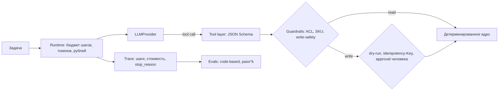

# Harness и guardrails

Реализовано в `src/harness/`:

| Механизм | Где | Проверяет |
|---|---|---|
| Бюджет шагов / токенов / рублей | `runtime.py` | `tests/unit/test_runtime.py` |
| Anti-loop (3 одинаковых вызова) | `runtime.py` | то же |
| Write только с `allow_write` и `approved` | `runtime.py`, `guardrails` | `test_runtime.py`, `tests/evals/test_guardrails_acl.py` |
| LLM только через `LLMProvider` | `llm.py` | мок `ScriptedLLM` для evals |
| Tool layer (read-only) | `tools/` | `get_catalog_item`, `validate_geometry` |

Не реализовано (волна 2): реальный провайдер LLM, MCP-слой к dbt/Airflow/Greenplum,
Text2SQL по семантическому слою, песочница (NemoClaw-подход), LLM-as-judge с калибровкой.
