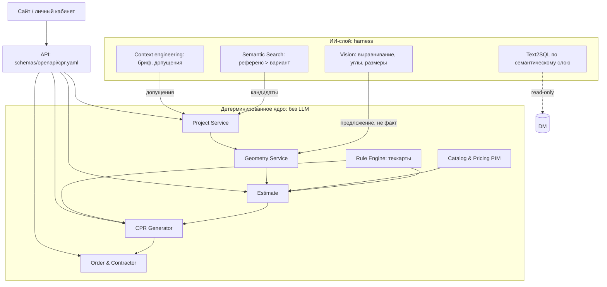

# Архитектура сервисов

| Система | Ответственность | Вход | Выход | SLA (цель v1) |
|---|---|---|---|---|
| Catalog & Pricing (PIM) | SKU, габариты, цены со снимком | выгрузки через S2T | позиция по SKU | чтение p95 < 200 мс |
| Geometry Service | контур, проёмы, площади | клиент, Vision (как предложение) | контур в мм, площади | валидация < 1 с |
| Rule Engine | подбор техкарт, объёмы | помещение, материалы, бриф | операции, расход, `needs_review` | < 500 мс |
| Estimate | бесплатный расчёт со SKU и диапазоном | техкарты + PIM | линии, итог, диапазон | < 3 с до первого результата |
| CPR Generator | сборка ЦПР, версии | всё выше | ЦПР по JSON Schema | < 60 с |
| Project Service | проект, бриф, допущения, версии | UI, ИИ-слой | состояние проекта | чтение < 300 мс |
| Order & Contractor | аукцион, заказ, передача ТЗ | согласованный ЦПР | ставки, заказ | write только с `Idempotency-Key` |
| AI harness | вызовы LLM, бюджеты, evals | задача | предложение + трейс | бюджет шагов/токенов/руб. |

SLA-цифры это целевые ориентиры для волны 1, их нужно подтвердить нагрузочным замером.
